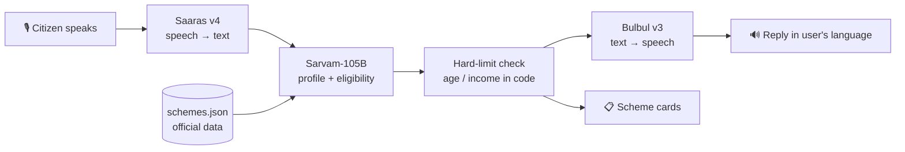

# 🏛️ Sarkari Sahayak

**Speak your situation in your own language. Find out which government benefits you're missing, and how to get them.**

Sarkari Sahayak is a voice-first assistant that helps Indian citizens discover welfare schemes they are eligible for. A delivery rider, farmer, widow or street vendor simply *talks* about their life in Telugu, Hindi, Hinglish or any of 10+ Indian languages, and the app replies with matching schemes, what they'll get, which documents to keep ready, and where to apply, read aloud in their own language.

Built on [Sarvam AI](https://www.sarvam.ai/) APIs: **Saaras v4** (speech-to-text), **Sarvam-105B** (reasoning) and **Bulbul v3** (text-to-speech).

---

## ❓ The problem

India runs thousands of welfare schemes covering pensions, insurance, health cover and farmer income support, yet many eligible people never claim them because:

- they don't know the scheme exists,
- the rules are written in complex English or formal Hindi,
- applying assumes you can read and fill online forms.

A gig worker earning ₹18,000/month may qualify for free accident insurance, a pension scheme and health cover without knowing about any of them.

## 💡 Example

> 🎙️ *"నేను హైదరాబాద్‌లో స్విగ్గీ డెలివరీ చేస్తాను. నెలకి 18 వేలు వస్తుంది. నా వయసు 28. పెళ్లి అయ్యింది, ఇద్దరు పిల్లలు."*
> *(I do Swiggy delivery in Hyderabad. I earn 18k a month. I'm 28, married, two kids.)*

The app:

1. Extracts a profile: **gig worker · 28 · ₹18,000/month · Telangana · married, 2 children**
2. Matches schemes: **e-Shram** 🟢, **PMJJBY** 🟡, **PMSBY** 🟡, **Atal Pension Yojana** 🟡
3. Correctly **excludes PM-SYM**, because its income limit is ₹15,000/month
4. Explains the result aloud **in Telugu** and asks one follow-up: *"Do you have a savings bank account?"*

## ✨ Features

- 🎙️ **Voice input in 22 Indian languages** with automatic language detection, including code-mixed speech like Hinglish
- 🔊 **Voice replies** in 11 languages, in the citizen's own language and script
- ✅ **Eligibility cards** marked *likely* or *possibly* eligible, each with the benefit, a reason, required documents, how to apply, and an **official source link**
- ❓ **Follow-up questions** that ask for the single most important missing fact; answers update the results
- 🛡️ **Grounded answers:** the model may only recommend schemes from a curated, source-linked database, and age and income limits are re-checked in code
- 🎭 **Demo citizens** for presenting without a microphone
- 🧠 **Careful mode** toggle to trade speed for accuracy

## ⚙️ How it works



| Step | Sarvam API | Role |
|---|---|---|
| 1 | **Saaras v4** (`/speech-to-text`) | Transcribes the citizen's speech and auto-detects the language |
| 2 | **Sarvam-105B** (`/v1/chat/completions`) | Extracts the profile, checks each scheme's rules, writes a spoken summary and a follow-up question |
| 3 | **Bulbul v3** (`/text-to-speech`) | Reads the summary aloud in the citizen's language |

## 📚 Schemes covered

All facts were collected from official sources (PIB releases, scheme rule PDFs, ministry portals and myScheme.gov.in) in October 2026. Each card in the app links to its source.

| Scheme | Benefit (summary) | For |
|---|---|---|
| **e-Shram** | Free UAN card for unorganised workers; gateway to other schemes | Workers 16+ |
| **PM-SYM** | ₹3,000/month pension after 60 | Unorganised workers 18–40, income ≤ ₹15,000/month |
| **PMJJBY** | ₹2 lakh life cover for ₹436/year | Ages 18–50 with a bank account |
| **PMSBY** | ₹2 lakh accident cover for ₹20/year | Ages 18–70 with a bank account |
| **Atal Pension Yojana** | ₹1,000–5,000/month pension after 60 | Ages 18–40, non-taxpayers |
| **Ayushman Bharat PM-JAY** | ₹5 lakh/year cashless hospital cover per family; all 70+ seniors | SECC/occupational criteria, 70+ |
| **PM-KISAN** | ₹6,000/year in three instalments | Landholding farmer families |
| **Widow Pension (IGNWPS)** | Central pension ₹300–500/month | BPL widows 40+ |
| **Old Age Pension (IGNOAPS)** | Central pension ₹200–500/month | BPL citizens 60+ |
| **PM SVANidhi** | Collateral-free loans ₹15k → 25k → 50k | Urban street vendors |

## 🚀 Getting started

### Prerequisites
- Python 3.10+
- A Sarvam AI API key from the [Sarvam dashboard](https://dashboard.sarvam.ai/)

### Setup

```bash
git clone https://github.com/<your-username>/sarkari-sahayak.git
cd sarkari-sahayak

python -m venv .venv
# Windows
.venv\Scripts\activate
# macOS / Linux
source .venv/bin/activate

pip install -r requirements.txt
```

Create your `.env` from the template and paste in your key:

```bash
cp .env.example .env      # Windows: copy .env.example .env
```

```env
SARVAM_API_KEY=your_key_here
```

### Verify your key

```bash
python check_setup.py
```

This makes one call to each API (Bulbul → Saaras round trip, then Sarvam-105B) and should print `All good!`.

### Run

```bash
streamlit run app.py
```

Then open **http://localhost:8501**.

## 🎮 Using the app

1. **Tap the mic** and describe yourself: job, age, monthly income, family, state. Or type in the box.
2. Or click a **demo citizen** in the sidebar:
   | Demo | Language | Expected highlights |
   |---|---|---|
   | 🛵 Ravi, delivery rider | Telugu | e-Shram, insurance, APY (PM-SYM excluded: income too high) |
   | 🌾 Ramesh, farmer | Hindi | PM-KISAN, e-Shram, PM-JAY |
   | 👵 Lakshmi, widow, 66 | Telugu | Widow pension, PM-JAY |
   | 🧕 Ayesha, street vendor | Hinglish | PM SVANidhi, PM-JAY, PM-SYM |
3. **Answer the follow-up question** to refine the results.
4. Use the sidebar to change the **reply language**, **voice**, or **Careful mode**.

## 📁 Project structure

```
sarkari-sahayak/
├── app.py            # Streamlit UI, prompt, eligibility logic and hard-limit checks
├── sarvam.py         # Thin wrappers for Saaras (STT), Sarvam-105B (chat) and Bulbul (TTS)
├── schemes.json      # Curated scheme database with official source URLs
├── check_setup.py    # Verifies the API key against all three APIs
├── requirements.txt
├── .env.example      # Template; copy to .env and add your key
└── README.md
```

### Adding a scheme

Append an object to `schemes.json`:

```json
{
  "id": "unique-id",
  "name": "Short name",
  "full_name": "Full official name",
  "category": "worker | farmer | insurance | pension | health | business | ...",
  "level": "central | <state>",
  "benefit": "One plain-English line with amounts",
  "eligibility": ["..."],
  "exclusions": ["..."],
  "age_min": 18, "age_max": 40,
  "income_max_monthly": 15000,
  "documents": ["Aadhaar", "Bank account"],
  "how_to_apply": "...",
  "apply_url": "https://...",
  "source_url": "https://... (official)",
  "verified_on": "YYYY-MM-DD"
}
```

`age_min`, `age_max` and `income_max_monthly` are enforced in code; set them to `null` when a scheme has no such limit.

## 🧠 Design notes and lessons learned

- **Reasoning improves correctness.** With thinking disabled, Sarvam-105B once claimed "₹18,000 is below the ₹15,000 limit". Careful mode (`reasoning_effort: "low"`) avoids this, at the cost of latency.
- **Reasoning tokens count against `max_tokens`.** At 4,096 the model spent the whole budget thinking and returned empty content. The app uses 16,000 in careful mode and retries once without reasoning if the response is still empty.
- **Prompted JSON over `json_schema` mode.** Strict structured-output mode sometimes caused the model to loop on whitespace inside string fields, so the schema is placed in the prompt and the JSON is parsed tolerantly.
- **Hard limits in code.** Numeric age and income checks run in Python after the model responds, and only scheme IDs that exist in `schemes.json` are shown. The model can't invent a scheme or slip on arithmetic.
- **Native script for TTS.** Replies are written in Devanagari or Telugu script rather than Roman letters, so Bulbul pronounces them naturally.

## ⚠️ Limitations

- **Latency:** Careful mode takes roughly 35–60s per answer; turn it off for ~5s responses with lower accuracy.
- **Pension amounts** shown are the **central share** only; states add top-ups, so actual amounts vary.
- **Some criteria can't be verified by voice**, for example BPL status or SECC listing, so those schemes are marked *possibly eligible*.
- Only 10 central schemes are included so far; state schemes are not yet covered.
- The REST speech-to-text endpoint handles clips of up to ~30 seconds.

## 🗺️ Roadmap

- [ ] Faster pipeline: quick extraction call → rule engine → quick summary call (~10s)
- [ ] More central schemes (Ujjwala, PM Awas, Matru Vandana, Sukanya Samriddhi, Vishwakarma)
- [ ] State schemes, starting with Telangana and Andhra Pradesh
- [ ] Document check: upload Aadhaar or ration card photos and verify them with Sarvam Vision
- [ ] WhatsApp voice-note bot
- [ ] Guided application form filling with spoken field confirmation

## ⚖️ Disclaimer

Sarkari Sahayak is an informational tool, **not an official government service**. Eligibility results are indicative only; always confirm on the official scheme portal or at your nearest Common Service Centre (CSC) before applying. Scheme rules and amounts change, so check the `verified_on` date in `schemes.json`.

## 🙏 Acknowledgements

- [Sarvam AI](https://www.sarvam.ai/) for the Saaras, Sarvam-105B and Bulbul APIs
- Scheme information from [myScheme](https://www.myscheme.gov.in/), [PIB](https://pib.gov.in/), [Jan Suraksha](https://www.jansuraksha.gov.in/), [NSAP](https://nsap.dord.gov.in/), [PM-KISAN](https://pmkisan.gov.in/) and other official portals
